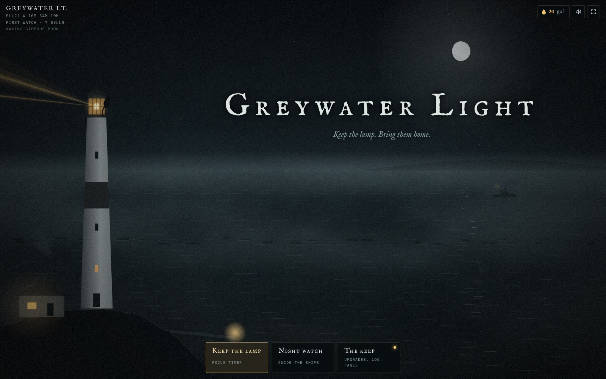
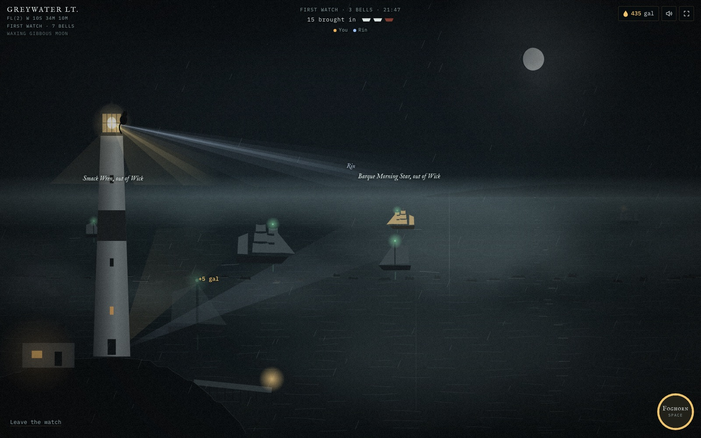
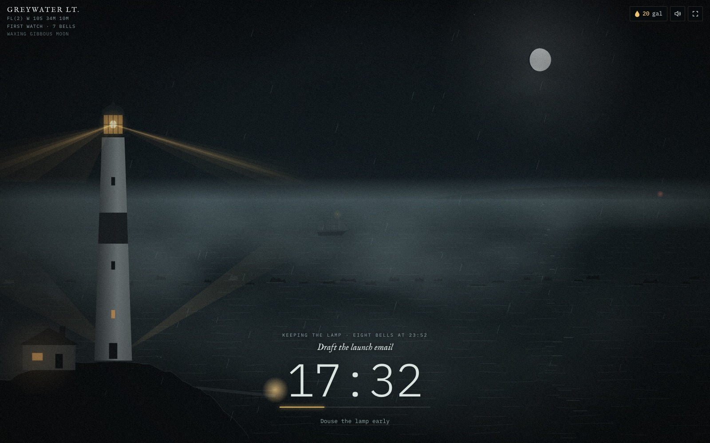
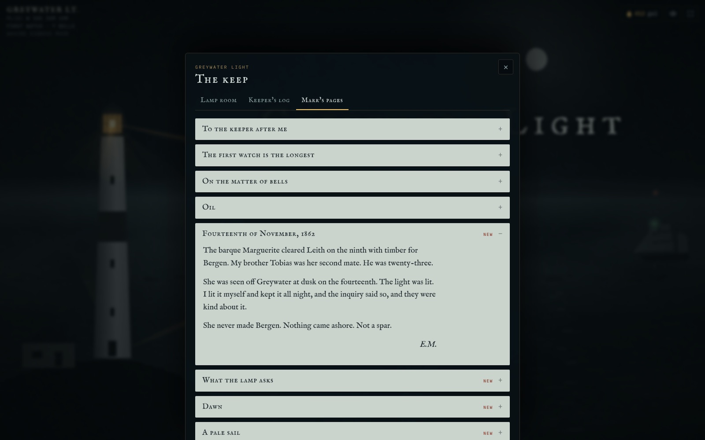
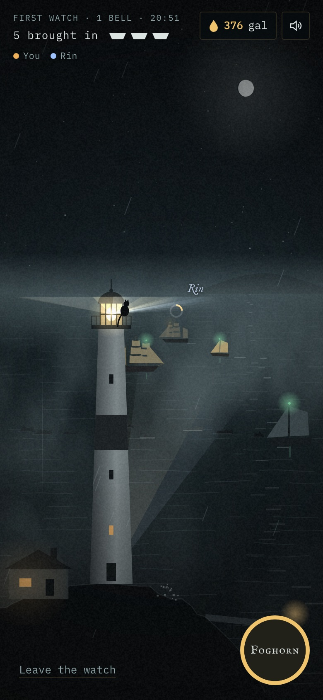

# Greywater Light

A moody lighthouse game that doubles as a focus timer. You are the new keeper of a light on a stormy northern rock. Keep the lamp lit while you work, guide ships through the fog on your breaks, and piece together what happened to the keeper before you.

## What's in it

**Keep the lamp (focus timer).** Name your task, pick 15 to 90 minutes and get to work. The lighthouse keeps itself, ships come in on its light, and the session goes into your log. When the time is up you hear eight ship's bells. The timer runs on the real clock, so you can switch tabs or close the page and come back. Afterwards you can take a 5-minute rest or play a night watch.

**Night watch (the game).** Aim the beam with your mouse or finger and hold it on each ship until her lamp turns green, before she reaches the reef. In fog you often only hear a ship: each one rings a bell from its side of the screen. The foghorn holds every ship back for a few seconds. A night runs from the first watch to dawn, about 12 minutes, and three wrecks end it early. The storm builds through the night.

**The keep.** Spend the oil you earn on real lighthouse gear: Fresnel lenses from sixth order to first order, fuels from whale oil to electric arc, clockwork and fog signals. Buy a stove, a cat and a gramophone for the cottage. Your log keeps every session, your streak and a 14-day chart.

**Marr's pages.** Sixteen pages from the old keeper's log unlock as you build up focus hours, ships and dawns. After enough hours, a pale ship with no lantern starts appearing on night watches.

| Night watch | Keep the lamp |
| --- | --- |
|  |  |

| Marr's pages | On a phone |
| --- | --- |
|  |  |

## Small real details

- The chart label shows the light's signature the way sea charts print it, for example `Fl(2) W 10s 34m 10M`.
- The time of day is shown as the current ship's watch and bell, from your own clock, and ship's bells ring on the half hour.
- The moon matches tonight's real phase.
- Every sound is synthesized live in the browser: the sea, wind, rain, thunder, ship's bells and four kinds of foghorn.

## Play

Open `index.html` in a browser, or publish the repo with GitHub Pages. There is no build step and nothing to install.

| Action | Mouse and keyboard | Touch |
| --- | --- | --- |
| Aim the beam | Move the mouse, or `←` `→` / `A` `D` | Drag |
| Foghorn | `Space` or `F` | Foghorn button |
| Leave a night watch | `Esc` | Leave the watch |
| Sound on or off | `M` | Speaker button |

Progress saves in your browser. The co-op night watch, where friends share one sea and each hold their own beam, and saving across devices only work when the page runs as a hosted claude.ai artifact. Opened as a plain file, the game runs solo.

## How it's built

One HTML file with no dependencies: canvas for the scene, the Web Audio API for sound, and Google Fonts for type. Open the page with `#selftest` at the end of the address to run its built-in checks for the moon phase, ship's bells, rewards and streaks.
